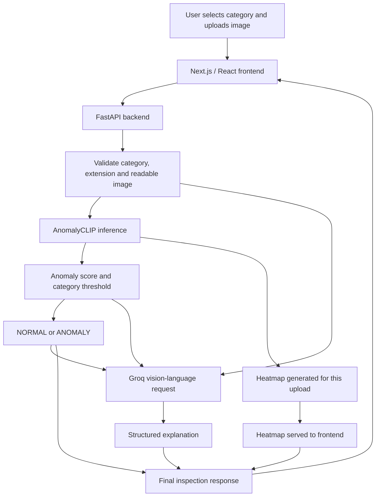

# Industrial Anomaly Detection with AnomalyCLIP, PatchCore, PaDiM, and Groq

An explainable industrial visual-inspection prototype that classifies product images as **NORMAL** or **ANOMALY**, produces a visual anomaly heatmap, and generates a readable inspection explanation using a vision-language model accessed through Groq.

The project includes both **comparative model experiments** (PatchCore and PaDiM) and the **final interactive application** (AnomalyCLIP + Groq). These are related parts of the project's development, but they should not be confused: the current website uses AnomalyCLIP for its prediction; PatchCore and PaDiM were evaluated separately during the research phase.

> **Project status:** Working local prototype. It is intended for academic demonstration and experimentation, not unsupervised use in production quality control.

---

## Table of Contents

- [Overview](#overview)
- [Objectives](#objectives)
- [Features](#features)
- [System Architecture](#system-architecture)
- [How an Inspection Works](#how-an-inspection-works)
- [Models Explored](#models-explored)
- [Datasets and Evaluation Protocol](#datasets-and-evaluation-protocol)
- [Experiment 1: PatchCore on MVTec AD](#experiment-1-patchcore-on-mvtec-ad)
- [Experiment 2: PaDiM on MVTec AD](#experiment-2-padim-on-mvtec-ad)
- [Exploratory PatchCore–PaDiM Consensus Analysis](#exploratory-patchcorepadim-consensus-analysis)
- [Experiment 3: External AnomalyCLIP Evaluation](#experiment-3-external-anomalyclip-evaluation)
- [Threshold Calibration](#threshold-calibration)
- [Technology Stack](#technology-stack)
- [Repository Structure](#repository-structure)
- [Local Setup](#local-setup)
- [Running the Application](#running-the-application)
- [Supported Image Formats](#supported-image-formats)
- [API Endpoint](#api-endpoint)
- [Limitations and Responsible Use](#limitations-and-responsible-use)
- [Licensing and Attribution](#licensing-and-attribution)
- [References](#references)

---

## Overview

Industrial inspection is used to identify defects in products such as bottles, cables, capsules, screws, tiles, transistors, and other manufactured objects. Manually checking every product can take time and may lead to inconsistent judgements.

This project investigates AI-based visual anomaly detection and builds an interactive application around a pretrained anomaly-detection model. A user selects a product category and uploads an image. The application returns:

1. An image-level **NORMAL** or **ANOMALY** prediction.
2. The model's anomaly score and the category-specific decision threshold.
3. A heatmap overlay showing regions with stronger anomaly-related responses.
4. A structured, human-readable explanation with an observation, reason, and recommended action.

The main objective is not just to display a classification label, but to make the result easier to inspect and understand.

## Objectives

- Study and compare established industrial anomaly-detection methods.
- Evaluate PatchCore and PaDiM on MVTec AD as separate baseline experiments.
- Investigate agreement between PatchCore and PaDiM predictions and heatmaps during the research phase.
- Evaluate AnomalyCLIP on external normal and anomalous product images.
- Build a complete user-facing application using Next.js, FastAPI, AnomalyCLIP, and Groq.
- Provide visual evidence through a heatmap and a plain-language explanation.
- Keep the final prediction traceable to the anomaly score and a fixed category-specific threshold.
- Document category-dependent performance and limitations rather than claiming that the system is reliable for every industrial setting.

## Features

- **15 product categories:** bottle, cable, capsule, carpet, grid, hazelnut, leather, metal nut, pill, screw, tile, toothbrush, transistor, wood, and zipper.
- **Image upload and preview** in the web interface.
- **Image-format validation** for JPG, JPEG, PNG, WEBP, and AVIF file extensions. Actual decoding still depends on the installed image libraries supporting the selected format.
- **Category-specific prediction threshold** for the AnomalyCLIP score.
- **Per-upload heatmap output** with a unique filename to avoid displaying an old heatmap from a previous inspection.
- **AI-generated explanation** through Groq's vision-capable model API.
- **Structured results** showing the category, prediction, score, threshold, heatmap, and explanation.
- **Local development architecture** that can be demonstrated through a browser without deploying the model to a public server.

## System Architecture



### Important separation of responsibilities

- **AnomalyCLIP** produces the final image-level detection prediction, anomaly score, and anomaly map used to make the heatmap.
- **The category-specific threshold** converts the score into `NORMAL` or `ANOMALY`.
- **Groq** provides a human-readable description based on the uploaded image and the prediction details. It does not replace or retrain AnomalyCLIP.
- **The heatmap is not a confirmed defect segmentation mask.** It is a visualisation of relative anomaly-related responses from the model.

## How an Inspection Works

1. The user chooses a product category and uploads an image.
2. The frontend checks the file extension and displays an image preview.
3. FastAPI validates the category, checks the extension, saves a temporary copy, and verifies that the file is readable.
4. The backend gives AnomalyCLIP a unique output path for the heatmap.
5. AnomalyCLIP extracts image and patch features, calculates an anomaly score, and generates an anomaly map.
6. The backend compares the score with the threshold for the selected category.
7. The anomaly map is saved as a JPEG heatmap overlay for that specific upload.
8. The backend sends the original image and the category, prediction, score, and threshold to Groq.
9. Groq returns an explanation organised into four sections: **Result**, **Observation**, **Reason**, and **Recommended Action**.
10. The frontend displays the prediction, score, threshold, heatmap, and explanation together.

The application currently waits for both detection and the explanation before showing the complete result. This is the chosen behaviour of the current UI.

## Models Explored

### PatchCore

PatchCore is an anomaly-detection method that represents normal training data with a memory bank of representative patch-level features. At inference time, image patches are compared against this memory bank; unusual feature distances can indicate anomalies. It is useful for localising defects as well as ranking images by anomalousness.

**Role in this project:** PatchCore was implemented and evaluated as a baseline experiment on MVTec AD. It was also used in an exploratory comparison with PaDiM. It is **not** the detector currently used by the interactive web application's prediction endpoint.

### PaDiM

PaDiM (Patch Distribution Modeling) models the distribution of normal patch features. At test time, it measures how far local features deviate from the learned normal distribution, using a Mahalanobis-distance-based anomaly measure.

**Role in this project:** PaDiM was implemented and evaluated independently on MVTec AD, then compared with PatchCore during the exploratory consensus phase. It is **not** currently used to determine the website's final prediction.

### AnomalyCLIP

AnomalyCLIP is a zero-shot anomaly-detection approach based on object-agnostic prompt learning. The final application loads a pretrained checkpoint and uses the model to obtain image-level and patch-level anomaly-related signals for inference. The model is not trained from scratch every time a user submits an image.

The application uses the checkpoint located at:

```text
AnomalyCLIP/checkpoints/9_12_4_multiscale_visa/epoch_15.pth
```

The checkpoint and model repository are not bundled into this project repository. See the official AnomalyCLIP repository for setup instructions and applicable terms.

**Role in this project:** AnomalyCLIP is the detector used in the current interactive application and the model used in the external-image evaluation reported below.

### Groq vision-language model

Groq provides access to a vision-language model that receives the original uploaded image and inspection details. The prompt requests a concise, structured explanation. The language model is used for communication and decision support; the threshold-based AnomalyCLIP result remains the displayed prediction.

The current backend is configured with the model ID `qwen/qwen3.8-27b`. Model availability and API limits depend on the provider and account, so check the provider's current documentation if setting up a new environment.

## Datasets and Evaluation Protocol

### MVTec AD

[MVTec AD](https://www.mvtec.com/research-teaching/datasets/mvtec-ad) is a benchmark for industrial anomaly detection. It contains more than 5,000 high-resolution images across 15 object and texture categories, with defect-free training images, normal and anomalous test images, and pixel-precise anomaly annotations.

The MVTec AD experiments were used for the PatchCore and PaDiM comparisons. The external AnomalyCLIP experiment described later used separate external images rather than treating the MVTec test set as external data.

**Leakage precautions used in the experiments:**

- PatchCore and PaDiM were fitted/evaluated according to the MVTec train/test structure; normal training images were used for the normal reference.
- Test anomaly images and their masks were not used to create the normal-image calibration percentiles.
- For external AnomalyCLIP testing, normal adaptation images were kept separate from the held-out test images.
- Anomaly images were not added to the external normal-adaptation set.
- After the category threshold was set, it was held fixed for that category's external test run.

### External-image evaluation

For each of the 15 categories, the external pilot evaluation used 10 held-out normal images and 10 held-out anomalous images. The threshold was calibrated with a separate set of normal adaptation images: 10 per category, except Cable, which used 11.

This is a small pilot evaluation. Some external anomaly images (particularly the Cable examples) were generic damaged product images and were not necessarily the same close-up defect patterns as those in MVTec AD. Results should therefore be interpreted as evidence from the specific test samples, not as a guarantee of real-world factory performance.

## Experiment 1: PatchCore on MVTec AD

PatchCore was evaluated on all 15 MVTec AD categories. The table reports image-level AUROC and pixel-level AUROC from the recorded project results.

| Category | Image AUROC | Pixel AUROC |
|---|---:|---:|
| Bottle | 1.0000 | 0.9853 |
| Cable | 0.9925 | 0.9836 |
| Capsule | 0.9908 | 0.9899 |
| Carpet | 0.9827 | 0.9902 |
| Grid | 0.9841 | 0.9797 |
| Hazelnut | 0.9999 | 0.9876 |
| Leather | 1.0000 | 0.9921 |
| Metal Nut | 0.9965 | 0.9878 |
| Pill | 0.9604 | 0.9818 |
| Screw | 0.9625 | 0.9792 |
| Tile | 1.0000 | 0.9563 |
| Toothbrush | 0.9250 | 0.9879 |
| Transistor | 0.9933 | 0.9606 |
| Wood | 0.9868 | 0.9335 |
| Zipper | 0.9761 | 0.9813 |

**Interpretation:** PatchCore produced strong image-level discrimination on many categories in this experiment. Performance varied by category, and image-level and pixel-level metrics measure different tasks: deciding whether an image is anomalous is not the same as precisely localising every defect pixel.

Recorded summary file in the development project: `results/patchcore_all_categories.csv`.

## Experiment 2: PaDiM on MVTec AD

PaDiM was also evaluated across all 15 MVTec AD categories. The following table reports the recorded image-level and pixel-level AUROC and F1 results.

| Category | Image AUROC | Image F1 | Pixel AUROC | Pixel F1 |
|---|---:|---:|---:|---:|
| Bottle | 1.0000 | 0.9920 | 0.9797 | 0.6860 |
| Cable | 0.8467 | 0.8290 | 0.9503 | 0.4198 |
| Capsule | 0.9107 | 0.9498 | 0.9819 | 0.4166 |
| Carpet | 0.9755 | 0.9655 | 0.9871 | 0.5332 |
| Grid | 0.8580 | 0.8545 | 0.9183 | 0.2432 |
| Hazelnut | 0.6146 | 0.8118 | 0.9709 | 0.4601 |
| Leather | 0.9980 | 0.9785 | 0.9890 | 0.3510 |
| Metal Nut | 0.9726 | 0.9534 | 0.9402 | 0.6414 |
| Pill | 0.8402 | 0.9428 | 0.9583 | 0.5368 |
| Screw | 0.7649 | 0.8676 | 0.9776 | 0.1846 |
| Tile | 0.9542 | 0.9186 | 0.9116 | 0.4941 |
| Toothbrush | 0.8667 | 0.9180 | 0.9886 | 0.5582 |
| Transistor | 0.9654 | 0.8649 | 0.9723 | 0.6324 |
| Wood | 0.9684 | 0.9483 | 0.9235 | 0.4182 |
| Zipper | 0.8989 | 0.9461 | 0.9684 | 0.4176 |

**Interpretation:** PaDiM's results were more category-dependent. For example, its recorded image AUROC was lower on Hazelnut and Screw than on several other categories. This comparison helped show why evaluating multiple anomaly-detection approaches is useful: different methods can behave differently across product categories and metric types.

Recorded summary file in the development project: `results/padim_results_summary.csv`.

## Exploratory PatchCore–PaDiM Consensus Analysis

As a research step, PatchCore and PaDiM outputs were also compared on a set of **436 image records across 15 categories**. This was an exploratory analysis, not the final prediction route in the web application.

The comparison recorded:

- Agreement between normalised anomaly scores.
- Agreement between the models' binary predictions.
- Intersection-over-Union (IoU) between thresholded heatmaps.
- A combined evidence-consistency score and its complementary uncertainty indicator.

The heuristic consensus score used in that analysis was:

```text
score_agreement = 1 - abs(normalised_patchcore_score - normalised_padim_score)
prediction_agreement = 1 if predictions match, else 0
heatmap_agreement = IoU between thresholded heatmaps

consensus_score = 0.40 * score_agreement
                 + 0.35 * prediction_agreement
                 + 0.25 * heatmap_agreement

uncertainty_score = 1 - consensus_score
```

The normalisation ranges for the final recalculation were derived from the 1st and 99th percentiles of scores from **MVTec train/good images**, by category. The held-out test anomalies were not used to calculate these normal-score calibration ranges.

| Category | Prediction Agreement | Heatmap IoU |
|---|---:|---:|
| Bottle | 100.00% | 0.2481 |
| Cable | 71.05% | 0.0896 |
| Capsule | 93.94% | 0.1758 |
| Carpet | 96.67% | 0.3341 |
| Grid | 85.00% | 0.1834 |
| Hazelnut | 60.71% | 0.1185 |
| Leather | 96.77% | 0.3107 |
| Metal Nut | 96.55% | 0.1872 |
| Pill | 88.10% | 0.1201 |
| Screw | 80.00% | 0.1301 |
| Tile | 83.33% | 0.2182 |
| Toothbrush | 100.00% | 0.3658 |
| Transistor | 76.00% | 0.1225 |
| Wood | 90.00% | 0.1900 |
| Zipper | 94.74% | 0.2412 |

**Important:** The consensus score and uncertainty indicator are heuristic evidence-consistency measures. They are **not calibrated probabilities** that an image is defective or that a prediction is correct. The final interactive UI does not currently combine PatchCore and PaDiM predictions. This experiment informed the development process, while AnomalyCLIP was selected for the final app's detector.

## Experiment 3: External AnomalyCLIP Evaluation

The final application's detector, AnomalyCLIP, was evaluated on separate external normal and anomalous images for all 15 categories. A category-specific threshold was calibrated using normal adaptation images and then fixed before evaluation.

### Aggregate metrics

| Metric | Macro average |
|---|---:|
| Accuracy | 83.67% |
| Precision | 91.49% |
| Recall | 76.67% |
| F1 score | 79.28% |
| False-positive rate | 9.33% |
| AUROC | 91.33% |
| Average precision | 93.00% |

### Per-category results

| Category | Accuracy | Precision | Recall | F1 | FPR | AUROC | Average Precision | Threshold |
|---|---:|---:|---:|---:|---:|---:|---:|---:|
| Bottle | 0.8500 | 0.7692 | 1.0000 | 0.8696 | 0.3000 | 0.9500 | 0.9497 | 0.8651 |
| Cable* | 1.0000 | 1.0000 | 1.0000 | 1.0000 | 0.0000 | 1.0000 | 1.0000 | 0.9346 |
| Capsule | 0.8000 | 0.8750 | 0.7000 | 0.7778 | 0.1000 | 0.9300 | 0.9421 | 0.7881 |
| Carpet | 1.0000 | 1.0000 | 1.0000 | 1.0000 | 0.0000 | 1.0000 | 1.0000 | 0.9469 |
| Grid | 0.8000 | 0.7143 | 1.0000 | 0.8333 | 0.4000 | 1.0000 | 1.0000 | 0.5531 |
| Hazelnut | 0.6000 | 1.0000 | 0.2000 | 0.3333 | 0.0000 | 0.6200 | 0.6847 | 0.7630 |
| Leather | 1.0000 | 1.0000 | 1.0000 | 1.0000 | 0.0000 | 1.0000 | 1.0000 | 0.5711 |
| Metal Nut | 0.7500 | 1.0000 | 0.5000 | 0.6667 | 0.0000 | 0.9500 | 0.9558 | 0.9368 |
| Pill | 0.6500 | 1.0000 | 0.3000 | 0.4615 | 0.0000 | 0.8000 | 0.8190 | 0.9574 |
| Screw | 0.9000 | 0.9000 | 0.9000 | 0.9000 | 0.1000 | 0.9800 | 0.9833 | 0.7531 |
| Tile | 1.0000 | 1.0000 | 1.0000 | 1.0000 | 0.0000 | 1.0000 | 1.0000 | 0.5484 |
| Toothbrush | 0.5500 | 0.5556 | 0.5000 | 0.5263 | 0.4000 | 0.6700 | 0.7569 | 0.6963 |
| Transistor | 1.0000 | 1.0000 | 1.0000 | 1.0000 | 0.0000 | 1.0000 | 1.0000 | 0.7800 |
| Wood | 0.9500 | 0.9091 | 1.0000 | 0.9524 | 0.1000 | 1.0000 | 1.0000 | 0.4597 |
| Zipper | 0.7000 | 1.0000 | 0.4000 | 0.5714 | 0.0000 | 0.8000 | 0.8585 | 0.9909 |

\* **Cable protocol note:** 11 normal adaptation images were used for Cable, compared with 10 for each of the other categories. Cable's external anomaly images were generic damaged cable examples and were not necessarily exact matches for MVTec's close-up defect patterns.

### Interpretation

- Macro-average AUROC was **91.33%** on this external pilot set, meaning the model generally ranked anomalous images above normal images well across categories.
- Macro-average accuracy was **83.67%** and macro F1 was **79.28%** at the chosen category thresholds.
- Performance varied substantially by category. Hazelnut, Toothbrush, Pill, and Zipper were more challenging in this sample.
- Some categories had high precision but lower recall, meaning the model rarely flagged normal images as anomalous at the chosen threshold but missed some anomalous images.
- A small external pilot set does not establish reliability under all factory lighting, cameras, product variations, or production conditions.

The final summary is recorded in `results/anomalyclip_external/all_categories_summary.csv` in the development project.

## Threshold Calibration

Each category uses a separate threshold because model score distributions can differ between product types.

For the external AnomalyCLIP evaluation:

1. A separate adaptation set of normal images was scored for each category.
2. The **99th percentile** of those normal-image scores was chosen as the threshold.
3. The threshold was then locked for the held-out external test images.
4. A test image was classified as `ANOMALY` if its score was greater than or equal to the threshold; otherwise, it was classified as `NORMAL`.

The 99th percentile was chosen to set a high cutoff based on normal-image scores, with the aim of reducing false alarms on normal products. The calibration sets were small, so the resulting thresholds are not guaranteed to be optimal for other environments.

**Anomaly scores are not defect probabilities.** For example, a score of `0.85` does not mean there is an 85% probability of a defect. It must be interpreted using the corresponding category-specific threshold.

The rule used by the current app is:

```python
if anomaly_score >= threshold:
    prediction = "ANOMALY"
else:
    prediction = "NORMAL"
```

## Technology Stack

| Component | Technology | Purpose |
|---|---|---|
| Frontend | Next.js, React, TypeScript | Image selection, preview, and result display |
| Backend API | FastAPI | Validates uploads and orchestrates inspection |
| Main detector | AnomalyCLIP | Image-level score, classification and anomaly map |
| Experimental baselines | PatchCore, PaDiM | Comparative experiments on MVTec AD |
| Explanation layer | Groq vision API (`qwen/qwen3.8-27b`) | Human-readable explanation from the image and result details |
| Image processing | Pillow, OpenCV, NumPy | Image loading, conversion and heatmap overlay creation |
| Deep learning | PyTorch | Model loading and inference |
| Dataset experiment | MVTec AD | Industrial anomaly-detection benchmark |

## Repository Structure

The repository is intended to contain the application code and recorded evaluation summaries, not the full datasets, model repository, checkpoints, or private API keys.

```text
industrial-anomaly-project/
├── src/
│   ├── backend.py
│   └── anomalyclip_inference.py
├── frontend/
│   ├── app/
│   │   └── page.tsx
│   ├── package.json
│   └── ...
├── results/
│   ├── patchcore_all_categories.csv
│   ├── padim_results_summary.csv
│   ├── consensus/
│   │   ├── consensus_results_summary.csv
│   │   └── per_image_evidence_fusion.csv
│   └── anomalyclip_external/
│       └── all_categories_summary.csv
├── .env.example
├── .gitignore
├── requirements.txt
└── README.md
```

The exact set of result files can differ depending on which development outputs you choose to commit. Do not commit original datasets, uploaded user images, model weights, virtual environments, `.env` files, or API credentials.

## Local Setup

### Prerequisites

- Python 3.10.x recommended for the tested AnomalyCLIP environment.
- Node.js and npm for the Next.js frontend.
- Git.
- A Groq API key.
- The official AnomalyCLIP repository and the required pretrained checkpoint, obtained according to that project's instructions.

### 1. Obtain AnomalyCLIP

Clone the [official AnomalyCLIP repository](https://github.com/zqhang/AnomalyCLIP) and follow its README to obtain the required model files. The current local code expects the `AnomalyCLIP` folder to sit alongside the application project folder, unless the paths in `src/anomalyclip_inference.py` are changed.

The checkpoint is not included in this repository because model files can be large and have their own distribution terms.

### 2. Configure the Groq API key

Create a local `.env` file in the project root, using `.env.example` as a template:

```text
GROQ_API_KEY=your_groq_api_key_here
```

Never commit the real `.env` file. If a key is accidentally exposed, revoke it and create a new one.

### 3. Set up the Python environment

Use a Python environment with the versions and dependencies compatible with the official AnomalyCLIP code. Install the dependencies listed in `requirements.txt` and follow AnomalyCLIP's own setup requirements for any additional packages.

The original development setup used the separate `AnomalyCLIP/.venv` virtual environment. On the original Windows machine, the backend was launched using that environment's Python executable and the `src` directory as the FastAPI application directory.

### 4. Start the backend

From the project root, the expected launch command is:

```powershell
python -m uvicorn backend:app --app-dir src --host 127.0.0.1 --port 8000
```

If your environment has the project configured exactly like the original Windows setup, use its AnomalyCLIP Python executable and the absolute path to the `src` folder. Keep the backend terminal running during the demo.

Open the API documentation at:

```text
http://127.0.0.1:8000/docs
```

### 5. Set up the frontend

Open a second terminal:

```powershell
cd frontend
npm install
npm run dev
```

Open:

```text
http://localhost:3000
```

The frontend currently calls the local backend at `http://127.0.0.1:8000`. If you change the backend host or port, update `API_URL` in `frontend/app/page.tsx` accordingly.

### Local-path note

The project was developed on Windows and some current source-code versions may contain local path assumptions. If you clone it into a different directory or run it on Linux/macOS, update the project and AnomalyCLIP path settings before running. A local setup working on the original machine does not by itself make the project production-deployable.

## Running the Application

1. Start the FastAPI backend in one terminal.
2. Start the Next.js frontend in a second terminal.
3. Open `http://localhost:3000`.
4. Choose the product category that matches the uploaded image.
5. Upload an image and check its preview.
6. Click **Inspect Image** and wait for the complete response.
7. Review the prediction, score, threshold, heatmap, and structured AI explanation.
8. Test both a known normal example and a known anomalous example.

**Demo tip:** Keep a few images that have already been tested successfully ready before presenting the project. A wrong category can affect the interpretation of the score and selected threshold.

## Supported Image Formats

The interface and backend accept these filename extensions:

- `.jpg` / `.jpeg`
- `.png`
- `.webp`
- `.avif`

The backend verifies that the uploaded file is readable before inference. AVIF decoding depends on support in the installed Pillow/image-codec environment. The explanation layer converts the image to RGB and encodes it as JPEG before sending it to the vision API.

## API Endpoint

### `POST /inspect`

Accepts multipart form data:

| Field | Type | Description |
|---|---|---|
| `file` | File | Uploaded product image |
| `category` | String | One of the 15 supported product categories |

Example response shape:

```json
{
  "category": "wood",
  "anomaly_score": 0.3417,
  "threshold": 0.4597,
  "prediction": "NORMAL",
  "heatmap_url": "/heatmaps/anomaly_map_wood_example.jpg",
  "explanation": "Result: NORMAL\nObservation: ...\nReason: ...\nRecommended Action: ..."
}
```

The values above illustrate the response format; they are not a guaranteed output for every image. The actual scores and predictions depend on the uploaded image and selected category.

The heatmap is served from `/heatmaps/...` and the frontend combines the local API base URL with `heatmap_url` to display it. The backend uses a unique filename for each inspection so the UI can request the heatmap corresponding to that request.

## Limitations and Responsible Use

- **Category dependence:** detection quality varies across categories and defect types.
- **Domain shift:** external images may differ from benchmark images in camera angle, lighting, background, resolution, product style, or defect appearance.
- **Small external test sets:** the external pilot evaluation contains only 20 test images per category. Results may change on larger or more representative samples.
- **Threshold sensitivity:** the 99th-percentile threshold is based on a small normal adaptation set and may need recalibration for a new production environment.
- **Heatmap interpretation:** highlighted regions represent relative model responses, not guaranteed defect boundaries or a pixel-accurate diagnosis.
- **Generated explanation:** Groq can make mistakes or describe details that are not supported by the image. Its output should be reviewed rather than treated as ground truth.
- **Runtime:** inference runs locally on the configured machine and can take time, especially on CPU. The Groq API also requires network access and may be affected by provider rate limits or service availability.
- **Not production-validated:** the application is an academic prototype. A real deployment would require larger-scale validation, monitoring, security review, and operational testing.
- **Local deployment:** the default frontend URL and file paths are intended for local development; the current application is not automatically public on the internet.

## Licensing and Attribution

- **MVTec AD:** The official MVTec AD page states that the dataset is distributed under the [CC BY-NC-SA 4.0 licence](https://www.mvtec.com/research-teaching/datasets/mvtec-ad), which restricts commercial use. Review the licence before redistributing data or using the dataset commercially.
- **AnomalyCLIP:** This project uses and builds on the [official AnomalyCLIP implementation](https://github.com/zqhang/AnomalyCLIP). Follow its repository licence, checkpoint terms, and any dependencies' licences.
- **PatchCore and PaDiM:** These methods are included as research baselines. Cite the original papers when reusing their methods or reporting these experiments.
- **Groq API:** Use requires a Groq API key and is governed by the provider's API terms, account limits, and current model availability. Keep keys secret and out of Git history.
- **Images:** Only upload images that you have permission to use. Do not commit external test images unless you have checked their licences and redistribution permissions.

## References

1. [AnomalyCLIP — Official implementation and paper details](https://github.com/zqhang/AnomalyCLIP)
2. [MVTec AD — Official industrial anomaly-detection benchmark](https://www.mvtec.com/research-teaching/datasets/mvtec-ad)
3. [Groq — Images and Vision documentation](https://console.groq.com/docs/vision)
4. [FastAPI documentation](https://fastapi.tiangolo.com/)
5. [Next.js documentation](https://nextjs.org/docs)
6. [PatchCore paper — *Towards Total Recall in Industrial Anomaly Detection*](https://arxiv.org/abs/2106.08265)
7. [PaDiM paper — *A Patch Distribution Modeling Framework for Anomaly Detection and Localization*](https://arxiv.org/abs/2011.08785)

## Summary

This project combines comparative anomaly-detection experiments with a working interactive inspection prototype. PatchCore and PaDiM were studied as baselines and compared during an exploratory consensus analysis. The final website uses AnomalyCLIP for the prediction and heatmap, then uses Groq to turn the image and prediction details into a structured natural-language explanation. The evaluation shows encouraging results on some categories and weaker generalisation on others, so further testing is required before any production use.
